# Последний шанс — дизайн-документ

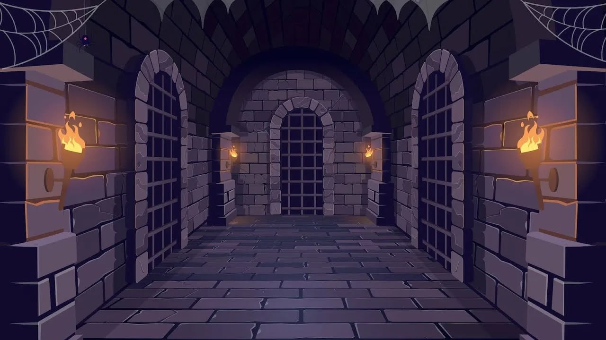
*Референс настроения: коридоры и двери Архива*

## Содержание

1. [Сеттинг, роль игрока и лор](#1-сеттинг-роль-игрока-и-лор)
2. [Геймплей и механики](#2-геймплей-и-механики)
   - [2.1. Основной игровой цикл](#21-основной-игровой-цикл)
   - [MVP](#mvp)
   - [2.2. Ключевые механики](#22-ключевые-механики)
   - [2.3. Управление](#23-управление)
   - [2.4. Система рун](#24-система-рун)
3. [Игровой мир](#3-игровой-мир)
4. [Враги и боссы](#4-враги-и-боссы)
5. [Стиль игры](#5-стиль-игры)

---

## 1. Сеттинг, роль игрока и лор

### Сеттинг

Мир «Последнего шанса» — руинированная магическая цивилизация, управлявшая реальностью с помощью письменности. Каждая руна была не просто символом, а законом мира: огонь, движение, жизнь, пространство, разрушение. Магия хранилась в огромном **Архиве** — месте, где были собраны все известные руны. В самом его сердце находилась **Первая Печать**, способная удерживать реальность от распада.

После события, которое назвали **Стиранием**, часть рун исчезла, двери Архива запечатались, а его хранители превратились в чудовищ. Магия перестала подчиняться людям.

### Лор

> *Когда-то слова творили мир. Потом слова стёрлись — и мир начал забывать сам себя. Архив закрыт, хранители потеряли облик, а руны, которые удерживали реальность, остались только в памяти тех, кто умеет их писать.*

### Роль игрока

Вы — молодой писец, который обнаруживает у себя способность воспроизводить утраченные символы. Он отправляется в Архив, чтобы добраться до его центра и остановить Стирание.

### Структура сюжета

Сюжет разворачивается в трёх актах внутри одной связанной локации — Архива.

- **Акт I. Пробуждение.** Герой входит в Архив и обнаруживает, что простейшие руны ещё работают. Он изучает магию, побеждает первых существ и находит записи о катастрофе.
- **Акт II. Ложная история.** В библиотеке герой узнаёт, что официальная версия событий неполна. Хранители не просто потеряли контроль над магией — они сознательно запечатали часть Архива. Чудовища оказываются бывшими хранителями, а собранные руны когда-то поддерживали печать.
- **Акт III. Истина.** Главный хранитель сообщает, что Первая Письменность — не обычный источник магии, а механизм, удерживающий нечто за пределами реальности.

### Главный сюжетный поворот

Архив не просто удерживает зло внутри. Он удерживает нечто, что должно было стереть саму магию из мира. И чем больше рун герой восстанавливает, тем ближе он подходит к освобождению этой силы.

### Финал

**Разрушить Печать:** герой стирает последний символ. Архив наполняется светом, магия возвращается в мир, а финальная сцена намекает, что последствия Стирания только начинаются.

### Референсы

| Игра | Что берём |
|---|---|
| [The Magus Circle](https://store.steampowered.com/app/2796640) | Обводка рун, изучение |
| [Runeomicon](https://store.steampowered.com/app/3160570) | Книга рун, процесс сражения |
| [In Verbis Virtus](https://store.steampowered.com/app/242840) | Комната с книгой, где игрок появляется |

**The Magus Circle** — обводка рун, изучение

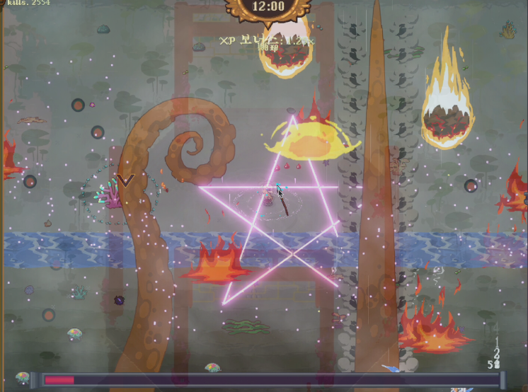

**Runeomicon** — книга рун, процесс сражения

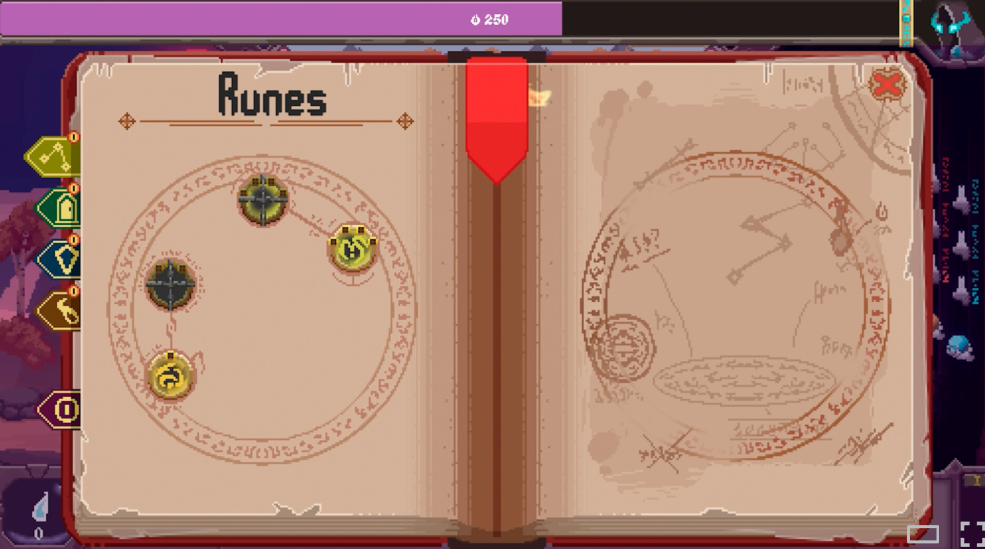
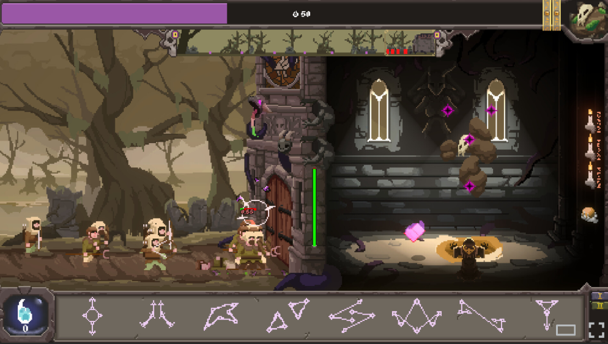

**In Verbis Virtus** — комната с книгой, где игрок появляется

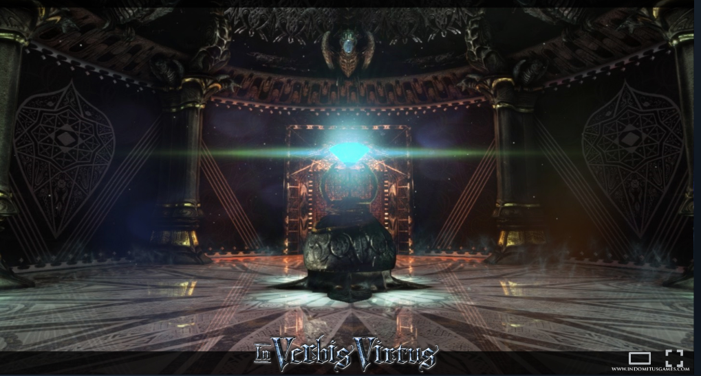

---

## 2. Геймплей и механики

**Жанр:** VR-экшен с жестовой магией.

**Ключевой принцип:** заклинание — это нарисованная в воздухе руна. Игрок не нажимает кнопку атаки, а чертит символ, и чем увереннее он владеет жестом, тем сильнее чувствует себя магом.

**Платформа:** PC VR (SteamVR), два контроллера, игровая зона примерно 4 × 4 м. Поворота стиком нет, игрок разворачивается сам.

### 2.1. Основной игровой цикл

Каждый уровень строится вокруг одного и того же цикла:

1. **Исследование комнаты:** игрок находит врагов, двери, страницы и подсказки.
2. **Обведение руны:** игрок выбирает символ и повторяет его форму в виртуальном пространстве.
3. **Сражение:** игрок применяет магию, уклоняется и побеждает врагов.
4. **Награда:** игрок получает осколки памяти и открывает новую страницу знаний.
5. **Новая печать:** игрок обводит руну на двери и открывает следующую область.

**Завершение уровня:** с каждого убитого моба растёт шкала загрузки новой руны. Когда шкала заполнена — уровень пройден.

#### Условия победы и поражения

**Победа:** уничтожены все противники на уровне: три обычных врага и мини-босс. Мини-босс появляется только после того, как убит последний обычный враг. После его смерти дверь в конце зала поднимается, на экран выводится сообщение о завершении уровня, игра останавливается.

**Перезапуск** — кнопкой меню на левом контроллере.

**Поражение:** когда здоровье игрока падает до нуля. Начальное здоровье — 6 единиц, восстановления нет.

**Урон по игроку:**

- обычный враг — 1 единица, если игрок ближе 1,3 м; не чаще раза в 1,6 с;
- мини-босс — 2 единицы, если игрок ближе 2 м; не чаще раза в 2,5 с.

Текущее здоровье постоянно выводится в поле зрения в формате «Жизни: X / 6». При каждом получении урона оба контроллера вибрируют.

При нуле здоровья игра выводит сообщение о поражении и через 4 секунды автоматически перезапускает уровень.

### MVP

**MVP проекта «Архив утраченных рун»**

| | |
|---|---|
| **Платформа** | PC VR (SteamVR, OpenXR), Unity 6 |
| **Цель** | Проверить основную механику — сотворение заклинаний рисованием рун в воздухе |

**Состав:**

- одна локация — зал 10 × 10 м с колоннами, факелами и запертой дверью;
- одна руна — огонь (зигзаг, рисуется одним штрихом);
- два типа противников — обычный враг и мини-босс;
- книга рун с подсказкой, как рисовать знак.

**Управление:**

- правый курок зажат — рисование руны кончиком палочки, отпущен — проверка рисунка и выстрел;
- нижняя кнопка левого контроллера — показать или скрыть книгу рун;
- левый стик — перемещение, правый — поворот;
- кнопка меню на левом контроллере — перезапуск.

**Механика заклинания:** во время рисования записывается траектория кончика палочки. После отпускания курка она сравнивается с шаблоном руны. Если похожесть выше порога, из палочки вылетает снаряд в направлении палочки с небольшой доводкой к ближайшему противнику. Если ниже — выстрела нет, контроллер вибрирует.

**Ход уровня:** обучающая подсказка → три обычных врага по очереди → мини-босс → открытие двери.

**Победа:** уничтожены все противники, дверь открывается.

**Поражение:** здоровье игрока (6 единиц) падает до нуля, уровень перезапускается через 4 секунды.

### 2.2. Ключевые механики

#### Оружие

Игрок вооружён магической палочкой в правой руке. От кончика палочки тянется светящийся след, пока рисуется руна.

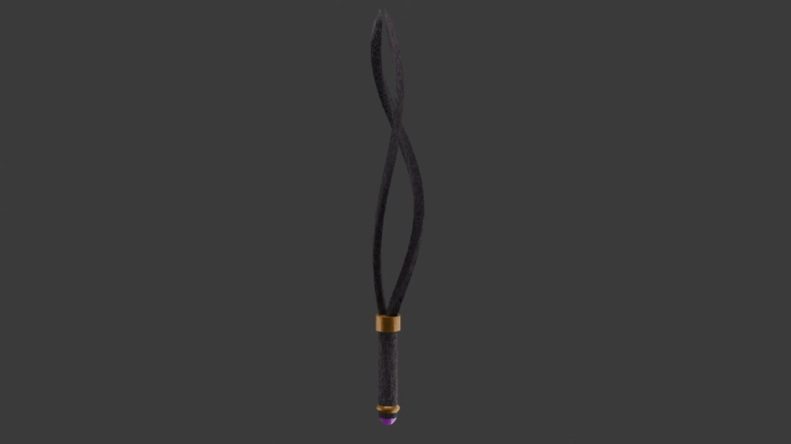
*Концепт палочки*

#### Атака жестом

1. Игрок зажимает курок — начинается запись движения кончика палочки, за ней тянется светящийся след.
2. Рисует руну одним штрихом. Точка записывается, если рука сдвинулась больше чем на 1 см.
3. Отпускает курок — жест распознаётся сразу, без задержки.
4. Получилось: из кончика палочки летит снаряд.
5. Не получилось: след гаснет, рука вибрирует, можно рисовать заново.

#### Распознавание

- Руна рисуется одним штрихом без отрыва, например «Искра» в виде молнии.
- Движение руки проецируется на плоскость перед игроком, подгоняется по размеру и числу точек (около 64).
- Рисунок сравнивается с шаблоном и получает оценку сходства от 0 до 1; порог около 0.75.
- Для реализации подойдёт $1 unistroke recognizer или готовый VR-плагин.
- Распознавание не должно быть слишком строгим: важна не идеальная точность, а прохождение ключевых участков символа. Игрок должен чувствовать, что управляет магией, а не сдаёт экзамен по каллиграфии.

#### Куда летит выстрел

Снаряд вылетает из кончика палочки и летит туда, куда направлена рука. Чтобы направление не «уезжало» во время рисования, берём направление палочки за последние 0.2 сек перед отпусканием курка: нацелился на врага, нарисовал, отпустил — снаряд полетел в его сторону.

#### Попадание

- Снаряд летит по прямой (или по баллистике) и наносит урон первому, во что врежется.
- Если не попал, снаряд пролетает мимо и пропадает при столкновении со стеной или по истечении времени жизни.

#### Тайминги

| Параметр | Значение |
|---|---|
| Минимальная длина жеста | 0.2 сек (короче — игнорируем) |
| Максимальная длина жеста | 2 сек (дольше — жест закрывается сам) |
| Пауза после выстрела | 0.3–0.5 сек |
| Время жизни снаряда | 3–5 сек |

#### Принципы обратной связи

- Руна распознаётся и при кривом, и при обычном жесте.
- Выстрел вылетает сразу после отпускания курка.
- Снаряд летит туда, куда направлена рука.
- Успех и провал отличаются и на глаз, и по вибрации.

#### Двери и печати

Двери открываются тем же принципом, но символ нанесён прямо на дверь. Игрок проводит контроллером по контуру, пройденные участки загораются; после правильного обведения линии вспыхивают, печать разрушается, и дверь открывается.

### 2.3. Управление

| Контроллер | Кнопка | Действие |
|---|---|---|
| Правый (палочка) | Курок | Зажал, нарисовал руну, отпустил — выстрел |
| Правый (палочка) | B / Menu | Пауза |
| Правый (палочка) | A | Взаимодействие с предметами и дверью |
| Правый (палочка) | Стик | Пока не используем |
| Левый | Стик вперёд и держать | Появляется дуга телепорта; отпустил — ты на месте |
| Левый | Grip | Показать или спрятать подсказку с рисунком руны |
| Левый | Курок, X, Y, нажатие стика | Пока свободны; можно повесить щит, смену руны, лечение |

#### Телепорт

- При перемещении экран на долю секунды темнеет (0.1–0.2 сек).
- Двигаться можно только по полу комнаты.
- Пока зажат курок для рисования, телепорт не работает, чтобы не сбить жест.

#### Вибрация

| Событие | Вибрация |
|---|---|
| Начало жеста | Слабая |
| Выстрел | Средняя |
| Руна не распозналась | Короткая двойная |
| Телепорт | Лёгкий импульс |
| Урон по игроку | Сильная на обе руки |

### 2.4. Система рун

Руны — часть единой системы: у каждого символа есть название, форма, эффект.

| Руна | Тип | Эффект | Роль | Получение |
|---|---|---|---|---|
| **1. Искра** | Основная | Быстрый магический снаряд | Основная атака | — |
| **2. Раскол** | Дополнительная | Более медленный, но мощный снаряд | Тяжёлая атака | После первого сюжетного уровня |
| **3. Импульс** | Дополнительная | Волна энергии вокруг игрока | Защита от нескольких близких врагов | После второго сюжетного уровня |
| **4. Печать** | Сюжетная | Открывает специальные двери | Прогресс по уровням | Сюжетная награда |

  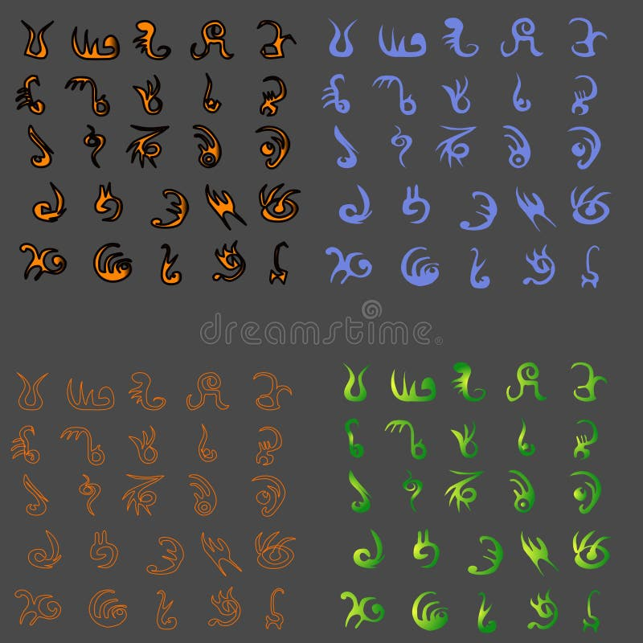
  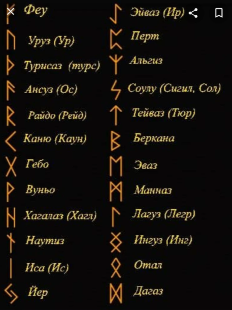

*Референсы рун*

#### Как игрок обводит руну

Игрок не рисует символ с нуля, а обводит готовую форму — механика доступнее и проще в реализации.

1. **Выбор страницы:** игрок поднимает магическую страницу перед собой; на ней символ с мягким свечением.
2. **Обведение:** игрок проводит контроллером по контуру, пройденные участки постепенно загораются.
3. **Распознавание:** когда большая часть контура пройдена в правильной последовательности, руна активируется.
4. **Применение:** игрок направляет руку на цель и нажимает кнопку активации либо заклинание запускается сразу после завершения обведения.

---

## 3. Игровой мир

**Локация:** Архив — главная локация с множеством дверей и одной главной дверью, за которой находится босс. Из центрального зала игрок попадает в отдельные комнаты-уровни и возвращается обратно.

### Структура уровня

- **Главная локация:** центральный зал с дверями; каждая дверь запечатана руной и ведёт в отдельный уровень.
- **Игровые комнаты:** на старте достаточно трёх законченных игровых пространств, из которых собираются все локации. Различия между ними задаются освещением, декором, цветом магии и перестановкой объектов.
- **Главная дверь:** открывается после прохождения комнат; за ней — босс.

**Условие прохождения комнаты:** убиваем мобов — растёт шкала загрузки новой руны; шкала заполнена — победа.

### Расстановка сил

- Обычные мобы — Клякса, Летописец, Страж-обломок.
- Босс — Страж Порога.
- Двери-печати и страницы с рунами как элементы прогресса.

### Предметы взаимодействия

- Магические страницы с рунами (обведение).
- Двери с символом-печатью.
- Надписи на стенах и записи Хранителей — подача сюжета.

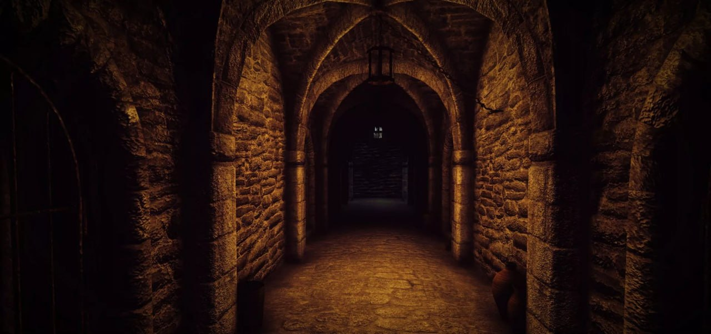
*Референс: коридор Архива*

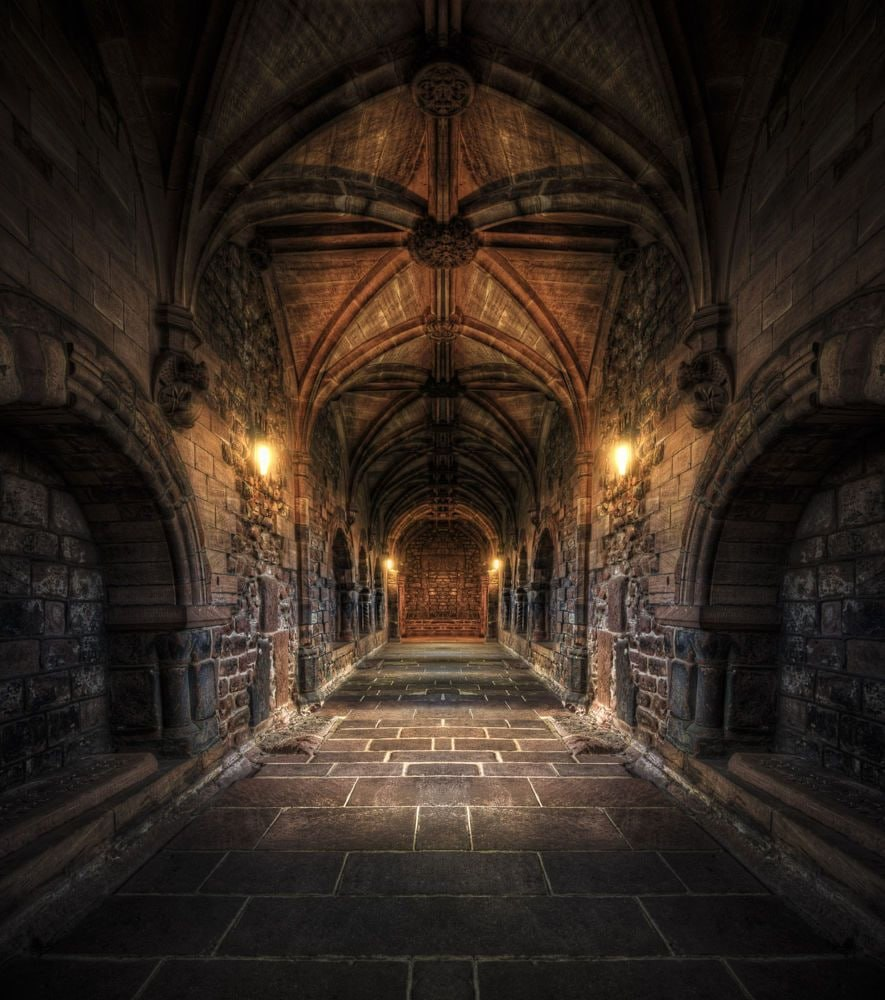

*Референс: главный зал с дверьми*

---

## 4. Враги и боссы

### Обычные противники

<table>
<tr>
<td width="140">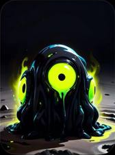</td>
<td>

**Моб 1. Клякса** — базовый противник

- **Внешность:** комок живых чернил с яркими глазами и неровным силуэтом.
- **Поведение:** медленно приближается и делает короткий бросок.
- **Тактика:** достаточно обвести базовую атакующую руну и попасть в цель.
- **Реализация:** простое перемещение к игроку, триггер дистанции атаки, здоровье и анимация смерти.

</td>
</tr>
<tr>
<td width="140">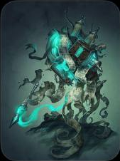</td>
<td>

**Моб 2. Летописец** — дальнобойный противник

- **Внешность:** раскрытая книга.
- **Поведение:** держит дистанцию и запускает снаряды.
- **Тактика:** игрок должен уклоняться и выбирать момент для ответной атаки.
- **Реализация:** парение, простая стрельба по таймеру, короткая пауза между атаками.

</td>
</tr>
<tr>
<td width="140">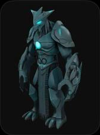</td>
<td>

**Моб 3. Страж-обломок** — тяжёлый противник

- **Внешность:** небольшой каменный голем с фрагментами древних надписей.
- **Поведение:** медленно подходит, замахивается и наносит сильный удар.
- **Тактика:** игроку нужно дождаться окончания замаха, уклониться и атаковать.
- **Реализация:** несколько состояний — ожидание, приближение, замах, удар, восстановление.

</td>
</tr>
</table>

### Босс — Страж Порога

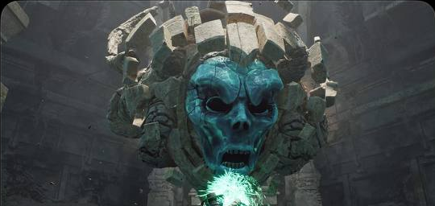
*Референс босса*

**Внешность:** высокий каменный хранитель с круглой печатью вместо лица. Его тело покрыто древними символами, часть которых погасла.

**Фазы боя:**

1. Страж медленно приближается и наносит удар по земле.
2. После удара он на несколько секунд теряет равновесие, а печать на груди загорается.
3. Игрок обводит руну и стреляет в уязвимую печать.
4. После нескольких успешных попаданий Страж падает, и открывается финальная дверь.

---

## 5. Стиль игры

**Арт-стиль:** тёмное фэнтези, древний каменный Архив с тёплым светом факелов; магия — холодное бирюзовое свечение рун, на фоне которого хорошо читаются снаряды, следы жестов и уязвимые точки врагов.

### Цели стиля

- **Читаемость:** руны, следы жестов, снаряды и опасности выделяются цветом и светом.
- **Атмосфера:** заброшенный, но живой магический Архив.

### Примеры зон

- **Главный зал:** каменные своды, тёплый свет факелов, двери со светящимися печатями.
- **Игровые комнаты:** тот же набор модулей, но с разным освещением, декором и цветом магии.
- **Зал босса:** массивная дверь, холодное свечение символов, часть которых погасла.
